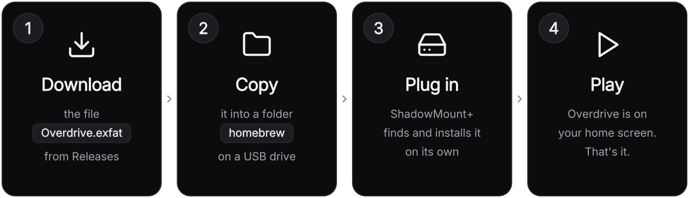

<p align="center">
  <picture>
    <source media="(prefers-color-scheme: dark)" srcset=".github/readme/logo-dark.svg">
    
  </picture>
</p>

<p align="center">
  <a href="README.md">English</a> ·
  <a href="README.ru.md">Русский</a> ·
  <a href="README.zh-CN.md">简体中文</a> ·
  <b>繁體中文</b>
</p>

<p align="center">
  <b>你的 PS5 遊戲商店。</b><br>
  它已起死回生——從自己的二進位檔中重新還原建置，原始碼每一行都完全公開。
</p>

<p align="center">
  <a href="https://github.com/MyLuxy/overdrive/releases/latest"></a>
  <a href="https://github.com/MyLuxy/overdrive/releases"></a>
  <a href="https://github.com/sponsors/MyLuxy"></a>
</p>

<p align="center">
  <a href="#四步安裝">安裝</a> ·
  <a href="#功能">功能</a> ·
  <a href="#更新">更新</a> ·
  <a href="#疑難排解">疑難排解</a> ·
  <a href="#自行建置">自行建置</a>
</p>

> [!NOTE]
> 原本的 Overdrive 專案已終止服務，因此我反編譯了最後一個發布版本，
> 復原出完整原始碼並重新建置了它。

<p align="center">
  
</p>
<p align="center">
  
  
</p>

## 功能

- **1800 多款遊戲**任你探索，還有**評分最高**、**新品**和精選推薦
- **瀏覽整個遊戲庫**，篩選、排序、評分與下載容量一目了然
- **直接下載到主機**，可存入內建儲存空間或任何 USB 隨身碟，即時顯示速度與儲存空間用量
- **收藏**、內建螢幕鍵盤的**搜尋**，還有可查看和清理儲存內容的**檔案**頁面
- **13 種語言**：English、Deutsch、Español、Français、Português (Brasil)、Русский、Bahasa Indonesia、日本語、简体中文、العربية、اردو、हिन्दी、বাংला
- **自我更新**：新版本直接在主機上安裝，不需要電腦
- 為控制器而生：<kbd>L1</kbd> <kbd>R1</kbd> 切換分區，<kbd>✕</kbd> 確認，<kbd>○</kbd> 返回

## 四步安裝

<p align="center">
  
</p>

### 開始之前

你需要一台**已破解的 PS5**，並執行兩個 payload：**[ShadowMount+](https://github.com/drakmor/ShadowMountPlus)**
（它會自行安裝 `.exfat` 映像檔）和 **[kstuff](https://github.com/EchoStretch/kstuff-lite/releases)**。
如果主機開機時 ShadowMount+ 顯示了通知，就表示準備就緒。你還需要一個 **USB 隨身碟**和一台
**電腦**。

<p align="center">
  <a href="https://github.com/MyLuxy/overdrive/releases/latest/download/Overdrive.exfat"></a>
</p>

<table>
<tr>
<td width="64" align="center" valign="top"></td>
<td>

**下載 `Overdrive.exfat`**：點上方按鈕，或前往
[最新 release](https://github.com/MyLuxy/overdrive/releases/latest) 頁面。這是你唯一需要的
檔案。保持原樣即可：不要解壓縮，也不要改動檔名結尾的 `.exfat`。

</td>
</tr>
<tr>
<td align="center" valign="top"></td>
<td>

**把它複製到 USB 隨身碟上一個名為 `homebrew` 的資料夾裡。** 把隨身碟插到電腦上，在它的
最上層新增一個名稱必須是 `homebrew`（全小寫）的資料夾，然後把 `Overdrive.exfat` 複製
進去：

```text
USB drive
└── homebrew
    └── Overdrive.exfat
```

隨身碟必須是 **exFAT** 格式——大多數隨身碟出廠即是如此，PS5 也只認這種格式。

</td>
</tr>
<tr>
<td align="center" valign="top"></td>
<td>

**把隨身碟插到 PS5 上。** ShadowMount+ 每隔幾秒檢查一次新檔案：它會找到 Overdrive，
掛載並安裝，完成後顯示通知。全程不需要任何操作。

</td>
</tr>
<tr>
<td align="center" valign="top"></td>
<td>


**在主畫面上開啟 Overdrive。** 找到這個圖示，盡情遊玩吧！

</td>
</tr>
</table>

你也可以用**任何 FTP 用戶端**把檔案傳到主機內建儲存空間，同樣放進 `homebrew` 資料夾：
`/data/homebrew/Overdrive.exfat`。

## 更新

Overdrive 只需手動安裝一次。新版本發布後，應用程式會在啟動幾秒後主動告訴你：

1. 彈出視窗顯示新版本與更新內容，按**安裝**。
2. Overdrive 下載更新、驗證並把它放到舊版本的位置上。
3. 完成後應用程式**自動關閉**。重新開啟，就是新版本了。

更新需要在存放 Overdrive 的那個儲存空間上保留約 **600 MB** 的可用空間。每個 release 裡的
`update.zip` 就是應用程式為此下載的升級包，你自己永遠用不到它。

## 支持本專案

Overdrive 免費且開源。如果你喜歡它，贊助能幫我持續維護下去。

<p align="center">
  <a href="https://github.com/sponsors/MyLuxy"></a>
</p>

## 疑難排解

<details>
<summary><b>主畫面上沒有出現 Overdrive</b></summary>
<br>

- 確認 **ShadowMount+ 正在執行**：它啟動時會顯示一則通知。
- 檢查資料夾：名稱必須完全是 `homebrew`，且位於隨身碟**最上層**，不能嵌在別的資料夾裡。
- 檢查檔名結尾仍然是 **`.exfat`**。有些電腦會隱藏副檔名：被改名成
  `Overdrive.exfat.zip` 或被解壓縮成資料夾的檔案都找不到。
- 稍等一分鐘：ShadowMount+ 會等檔案完整複製完之後才安裝它。

</details>

<details>
<summary><b>更新之後，應用程式顯示的還是舊版本</b></summary>
<br>

新版本其實已經裝好，只是主機裡還載入著舊的。**重新啟動主機**再開啟 Overdrive 即可；如果
這種情況連續發生，應用程式自己也會提醒你。

</details>

<details>
<summary><b>更新時提示空間不足</b></summary>
<br>

更新檔會下載到已安裝應用程式的旁邊，所以存放 Overdrive 的那個儲存空間需要約 600 MB 的
可用空間。在那個儲存空間騰出一些位置，然後按**重試**。出錯時什麼都沒有被變更。

</details>

<details>
<summary><b>更新時提示無法取代應用程式</b></summary>
<br>

手動安裝即可：從[最新 release](https://github.com/MyLuxy/overdrive/releases/latest) 下載
`Overdrive.exfat`，關閉 Overdrive，然後把新檔案覆蓋 `homebrew` 資料夾裡的舊檔。

</details>

<details>
<summary><b>如何移除 Overdrive？</b></summary>
<br>

先刪除 `homebrew` 資料夾裡的 `Overdrive.exfat`，再從主畫面刪除它的圖示。順序反了的話，
ShadowMount+ 會重新找到檔案，把圖示裝回來。

</details>

## 自行建置

<details>
<summary><b>這個儲存庫裡有什麼</b></summary>
<br>

| 路徑 | 是什麼 |
| --- | --- |
| `app/` | 應用程式本體：JSX 原始碼、狀態、資源、目錄資料，以及 `app.json`（標題 ID `PPSA99058`、版本、權限） |
| `ps5-react/` | 它所執行的框架，隨儲存庫內建，源自 [half144/ps5-react](https://github.com/half144/ps5-react) |
| `packaging/make-exfat.sh` | 建置 ShadowMount+ 所安裝的 exFAT 映像檔 |
| `.github/workflows/build.yml` | 建置流程 |

</details>

<details>
<summary><b>原始碼是怎麼找回來的</b></summary>
<br>

Overdrive 是一個執行在 [ps5-react](https://github.com/half144/ps5-react) 上的 React 應用
程式，它的整份 JavaScript bundle 以明文形式內嵌在 `eboot.bin` 裡。打包器會把所有模組
合併進同一個作用域，模組之間的 import 因此變成了裸名稱；好在每個頂層名稱都保持唯一，
於是宣告這個名稱的模組可以重新推算出來。憑藉這一點，bundle 被拆回了 137 個原始模組，
並還原出真實的 `import`/`export` 語句，再與原 bundle 逐一比對，直到每一條 import 依賴
都對得上。

打包器丟掉的東西是找不回來的：大部分註解、JSX 語法（讀出來是 `jsx(View, {…})` 呼叫），
以及 `const`/`let`（現在是 `var`）。這些都不影響應用程式的行為。

</details>

<details>
<summary><b>開發</b></summary>
<br>

一切都從儲存庫根目錄透過 npm 執行。克隆之後執行一次 `npm run setup`
（`packaging/setup.sh`）即可裝齊全部依賴：Linux 上是桌面預覽、PS5 建置與測試所需的
apt 軟體包（會請求一次 `sudo`），macOS 上則是 Homebrew 套件；接著是 Pillow 和框架的
npm 套件。想自己手動安裝的話，請先讀一遍這個指令碼。

```sh
git clone https://github.com/MyLuxy/overdrive.git
cd overdrive
npm run setup        # 僅需一次；Linux 上會請求 sudo
npm run dev          # 在電腦視窗裡執行應用程式，app/ 下每次儲存都會重新建置
```

| 指令 | 作用 |
| --- | --- |
| `npm run setup` | 安裝全部依賴，克隆後執行一次 |
| `npm run dev` | 開啟桌面預覽，隨儲存自動重建（重新啟動後狀態會重置） |
| `npm run preview` | 只開啟一次桌面預覽，不監看變更 |
| `npm test` | 框架自檢；改動 `ps5-react/` 後需要跑，只改 `app/` 則不必 |
| `npm run build` | 建置 PS5 應用程式，然後產生 `Overdrive.exfat` 與 `update.zip`（見「建置」） |
| `npm run build:app` | 只建置 PS5 應用程式，輸出在 `ps5-react/dist/PPSA99058` |

預覽就是跑在你電腦上的主機 UI，支援控制器或鍵盤，滑鼠則作為開發者的快捷操作。第一次
`npm run dev` 會下載並編譯框架鎖定的依賴，耗時較久；之後再啟動就很快了。

| 操作 | 鍵盤 | 滑鼠 | PS5 |
| --- | --- | --- | --- |
| 移動焦點 | 方向鍵 | 滾輪（上下） | 十字鍵 |
| 確認 | Enter 或空白鍵 | 左鍵點擊元素 | ✕ |
| 返回 | Backspace | 右鍵 | ○ |
| 切換分區 | Q / E | — | L1 / R1 |
| 收藏 | F | — | □ |
| 結束預覽 | Escape | — | PS 按鈕 |

應用程式的程式碼在 `app/` 下（見「這個儲存庫裡有什麼」）；改動那裡不需要重新建置框架。
新增面向使用者的字串時，`app/i18n/locales/` 裡的每個語言檔都要寫上。Linux 上預覽用
clang 編譯（`CC=clang CXX=clang++`，由 npm 指令碼設定），因為 GCC 會在
`archive_preflight.cpp` 的一個邊界警告處中斷。預覽的 Linux 支援是本 fork 新增的；
上游 ps5-react 只支援 macOS。

</details>

<details>
<summary><b>建置</b></summary>
<br>

建置在 `ubuntu-24.04` 上以 clang 18 進行，且只能透過 **Run workflow** 手動觸發：直接
push 不會建置任何東西。每次執行會把 `Overdrive.exfat` 和 `update.zip` 放進一個以
`app/version.js` 命名的草稿 release 裡，僅維護者可見。

在本機做同樣的建置（儲存庫根目錄下、`npm run setup` 之後，見「開發」）：

```sh
npm run build        # 先建置應用程式，再在此處產生 Overdrive.exfat 與 update.zip
npm run build:app    # 只建置應用程式，輸出在 ps5-react/dist/PPSA99058
```

背後的 `packaging/build.sh` 會在 apt 或 Homebrew 安裝 LLVM 18 的位置找到它（否則請
設定 `LLVM=<其 bin 目錄>`），透過 `ps5-react/tools/build_ps5.py` 完成建置，然後以
`sudo` 執行 `packaging/make-exfat.sh`，因為映像檔要先掛載才能填充。建置會把它鎖定的
依賴下載到 `ps5-react/.deps`，並把應用程式資料夾、一個 `.zip` 和一個 `.receipt.json`
寫入 `ps5-react/dist`。建置自帶驗證（`tools/verify.py`），所以只要建置通過（綠色），
payload 結構和簽名就都檢查無誤了。

映像檔是一個普通的 exFAT 磁碟區，根目錄即應用程式資料夾，叢集大小 64 KiB，磁碟區標籤
`OVERDRIVE`。發布新版本時：提升 `app/version.js` 與 `app/app.json` 裡的版本號，執行
workflow，在主機上測試草稿裡的映像檔，然後發布草稿——這會建立對應的 tag，已安裝的
應用程式下次啟動時提供的就正是這些測試過的檔案。

</details>

<details>
<summary><b>相對上游 ps5-react 的修正</b></summary>
<br>

內建框架裡有兩處修正，都在建置工具裡，也都是 Linux 建置回報出來的：

- `ps5-react/tools/common.py` 按固定的空格數去讀 `git apply --summary` 的輸出行，導致
  檔案模式與路徑黏在一起（`100644 <path>`），每次全新檢出依賴都會在第一個建立檔案的
  補丁上失敗。現在改為按空白分割。
- `ps5-react/tools/build_ps5.py` 用 `tarfile` 開啟鎖定 LLVM 套件的 `data.tar.zst`，但
  `tarfile` 要到 Python 3.14 才支援 zstd，而文件標注的最低版本是 3.12。現在會改用
  `zstd` 指令作為後備。

框架的其餘部分沒有任何改動。

</details>

## 致謝

- **[MyLuxy](https://github.com/MyLuxy)**，反編譯了 Overdrive，找回原始碼並重建了它。
- **[ps5-react](https://github.com/half144/ps5-react)**，它所執行的框架。
- **[ShadowMount+](https://github.com/drakmor/ShadowMountPlus)**，作者 drakmor，負責安裝它。

`ps5-react/` 採用 GPL-3.0-or-later 授權，並自帶 `LICENSE`、`LICENSE-ATTRIBUTION` 與
`NOTICE`。每份依賴聲明都會複製進建置產物的 `notices/` 目錄，
`ps5-react/docs/DEPENDENCIES.md` 列出了它們及其來源。

<sub>Overdrive 是一個非官方的自製（homebrew）軟體專案，與 Sony Interactive Entertainment
無從屬關係，也未獲其認可。PlayStation 和 PS5 是 Sony Interactive Entertainment 的商標。</sub>
